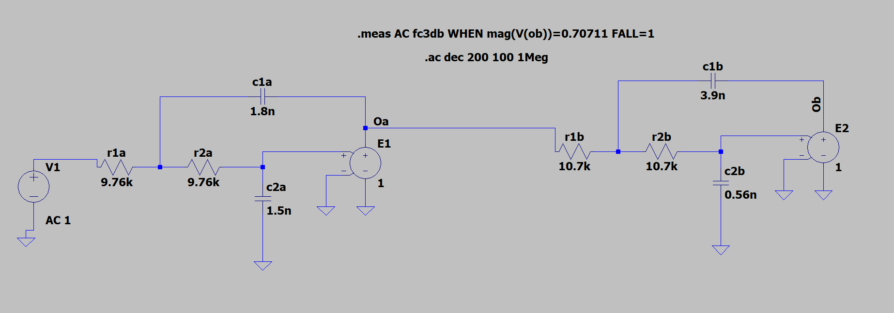
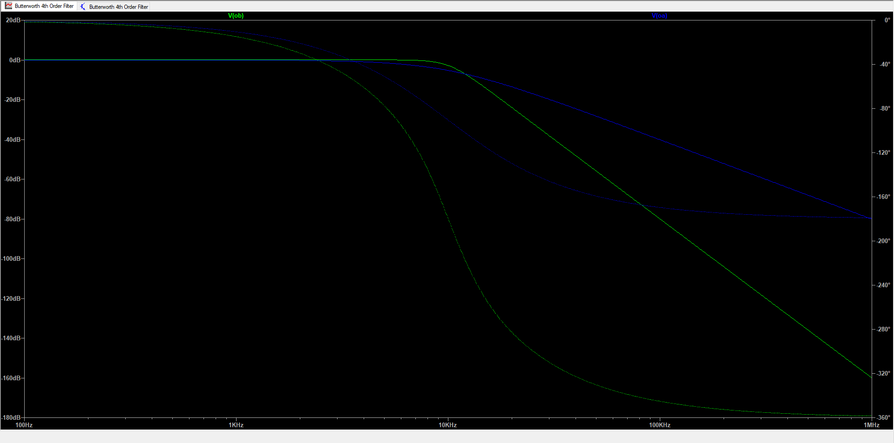
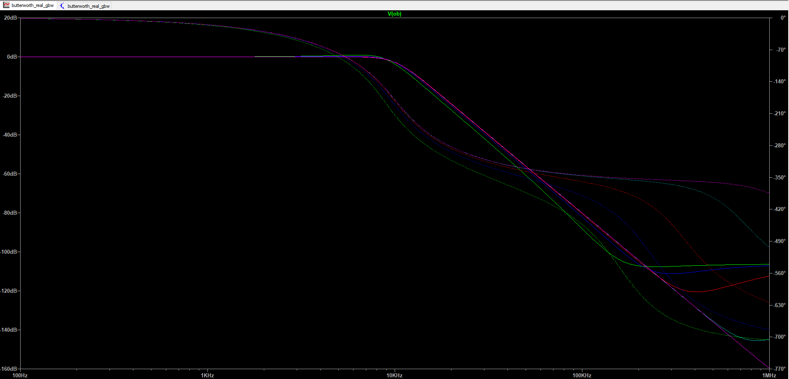
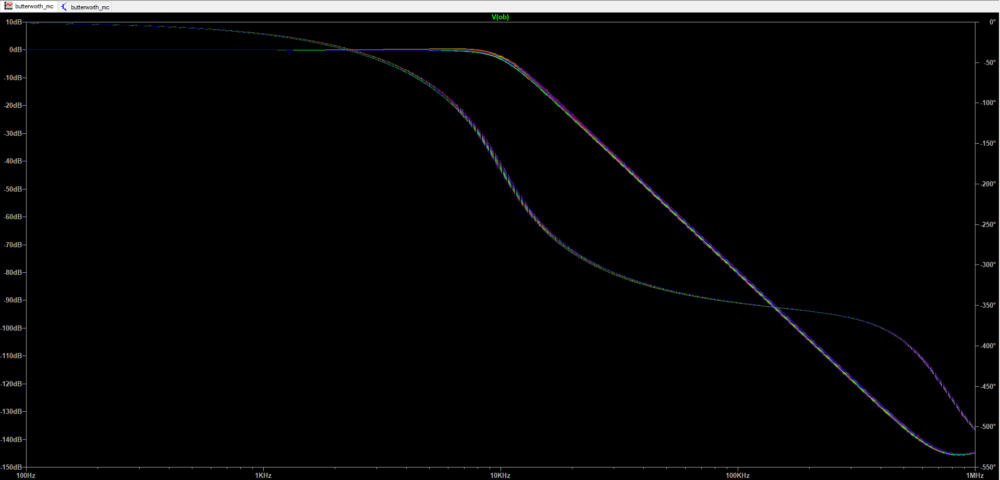

# 4th-Order Butterworth Low-Pass Filter (Sallen-Key), LTspice

A 4th-order Butterworth low-pass filter with a 10 kHz cutoff, built from two cascaded unity-gain Sallen-Key stages. The design was derived by hand and then checked in LTspice with ideal buffers, a real op-amp model (gain-bandwidth sweep) and a Monte Carlo tolerance analysis.

## Specification

| Item | Value |
|---|---|
| Response | Maximally flat (Butterworth) low-pass |
| Order | 4 (two second-order sections) |
| Target cutoff (-3 dB) | 10 kHz |
| Topology | Two unity-gain Sallen-Key stages in cascade |
| Resistor base value | 10 kOhm (tuned per stage for standard capacitors) |

## Design method

1. **Transfer function of one stage.** With R1 = R2 = R, a unity-gain Sallen-Key low-pass has
   H(s) = 1 / (s^2 R1 R2 C1 C2 + s C2 (R1 + R2) + 1), giving
   w0 = 1 / (R sqrt(C1 C2)) and Q = 0.5 sqrt(C1 / C2). C1 is the feedback capacitor and C2 goes to ground.
2. **Butterworth Q values.** The four poles lie on a circle of radius w0 at 22.5 and 67.5 degrees from the negative real axis. A pole at angle theta has Q = 1 / (2 cos theta), so the two stages have Q = 0.5412 (theta = 22.5 degrees) and Q = 1.3066 (theta = 67.5 degrees). Both stages use w0 = 2 pi x 10 kHz.
3. **Component values.** Exact values for R = 10 kOhm, then the nearest E12 capacitors:

| Stage | Q target | C1 exact | C2 exact | C1 used | C2 used | Resulting Q |
|---|---|---|---|---|---|---|
| A | 0.5412 | 1.723 nF | 1.470 nF | 1.8 nF | 1.5 nF | 0.548 |
| B | 1.3066 | 4.159 nF | 0.609 nF | 3.9 nF | 0.56 nF | 1.319 |

4. **Tuning with R.** With standard capacitors and R = 10 kOhm, stage cutoffs drift to 9.69 kHz and 10.77 kHz. Q depends only on the capacitor ratio, so R was adjusted per stage: 9.76 kOhm (stage A, f0 = 9.92 kHz) and 10.7 kOhm (stage B, f0 = 10.06 kHz).

The hand derivation is in `Derivation Notes.docx`.

## Files

| File | Contents |
|---|---|
| `butterworth_ideal.asc` | Schematic with ideal unity-gain buffers (voltage-controlled sources) |
| `butterworth_real_gbw.asc` | Real op-amp (UniversalOpAmp2, Avol = 1 Meg, slew = 10 Meg/us) with a stepped gain-bandwidth |
| `butterworth_mc.asc` | Real op-amp with Monte Carlo tolerances, 50 runs |
| `ideal_schematic.png`, `real_gbw_schematic.png`, `mc_schematic.png` | Screenshots of the three circuits |
| `ideal_bode.png` | Magnitude and phase, ideal buffers, stage A output (blue) and filter output (green) |
| `gbw_sweep_bode.png`, `gbw_sweep_fc3db.txt` | Response and -3 dB frequency for five GBW values |
| `mc_curves.png`, `mc_fc3db.txt` | 50 overlaid responses and the 50 measured -3 dB frequencies |

## Results

### 1. Ideal buffers

The -3 dB point is **10,102 Hz**, 1% above the 10 kHz target. The output falls at 80 dB per decade and the phase reaches -360 degrees, as expected for four poles. Stage A alone falls at 40 dB per decade and reaches -180 degrees.

   

   

### 2. Real op-amp, gain-bandwidth sweep

| GBW | -3 dB frequency | Error vs ideal (10,102 Hz) |
|---|---|---|
| 100 kHz | 9,726 Hz | -3.7% |
| 300 kHz | 10,041 Hz | -0.6% |
| 1 MHz | 10,094 Hz | -0.08% |
| 10 MHz | 10,101 Hz | -0.01% |
| 100 MHz | 10,102 Hz | -0.005% |

For this 10 kHz filter, a GBW of 300 kHz (30 times the cutoff) or more kept the cutoff within 1% of the ideal value. At 100 kHz (10 times the cutoff) the error was 3.7%. Only these five GBW values were simulated, so the exact threshold lies somewhere between 100 kHz and 300 kHz. The real op-amp also changes the high-frequency behaviour: instead of continuing to fall at 80 dB per decade, the stopband flattens at a level that depends on GBW.

   

### 3. Monte Carlo tolerance analysis

50 runs, resistors at 1% and capacitors at 5% (uniform distribution, `mc()` function), real op-amp at its default settings (GBW = 10 MHz).

| Statistic | Value |
|---|---|
| Nominal (no tolerance) | 10,101 Hz |
| Mean | 10,091 Hz |
| Standard deviation | 211 Hz (2.1%) |
| Minimum | 9,680 Hz (-4.2%) |
| Maximum | 10,558 Hz (+4.5%) |
| 5th to 95th percentile | 9,794 Hz to 10,500 Hz |

The mean is within 0.1% of nominal, so the tolerances scatter the cutoff in both directions without biasing it. With these part tolerances the cutoff is only reliable to about +/-5%.

   

## Limitations

- The analysis is small-signal AC. Supply rails, output swing and slew rate are not modelled; the +/-5 V supplies are included for completeness only.
- The GBW sweep uses five values, and the Monte Carlo uses 50 runs, so the extreme values (minimum and maximum) would change with another set of random draws. The mean and standard deviation are more stable.
- The Monte Carlo run varies all components together, so it does not show which components set the spread.

## Possible extensions

- Repeat the Monte Carlo with 1% capacitors to see how much of the spread comes from the capacitors.
- Refine the GBW sweep between 100 kHz and 300 kHz.
- Build the circuit on a breadboard and compare with the simulation.

## How to reproduce

1. Open any `.asc` file in LTspice (free from Analog Devices).
2. Run the simulation (the `.ac` analysis is already set up). The -3 dB frequency is reported in the SPICE error log (`Ctrl+L`) as `fc3db`.
